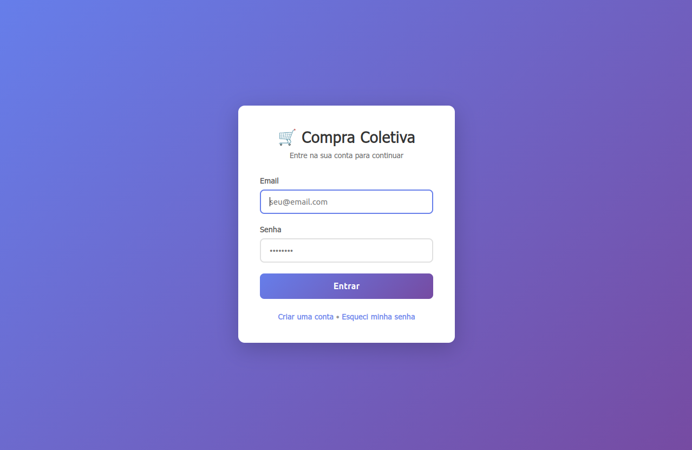
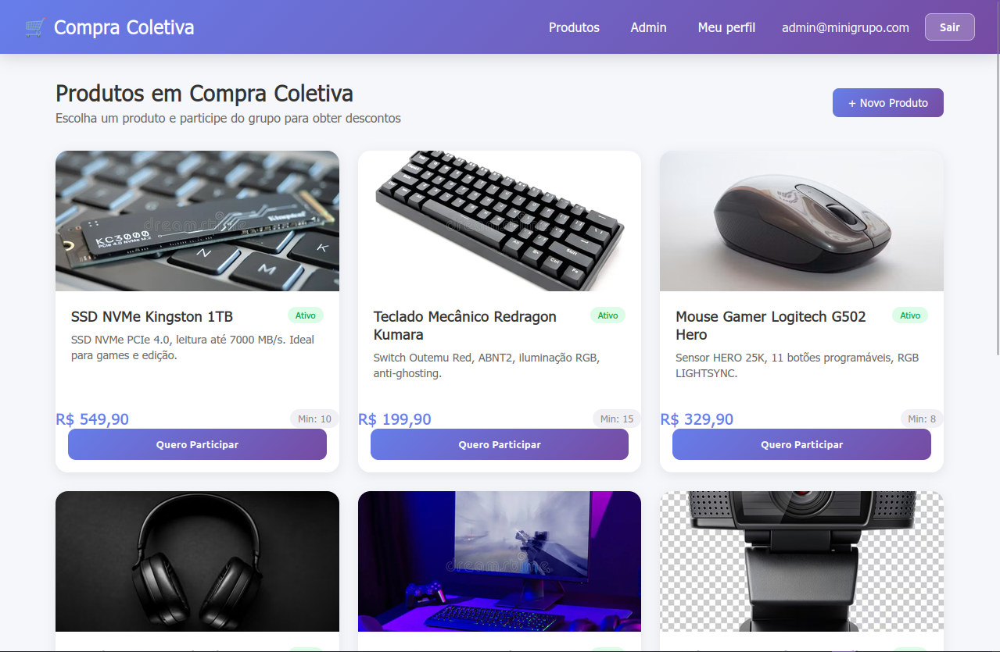
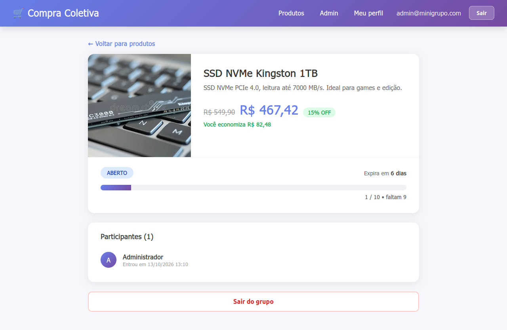
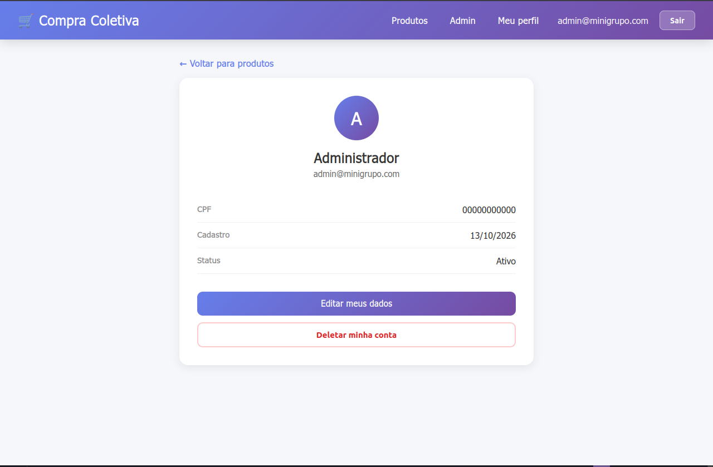
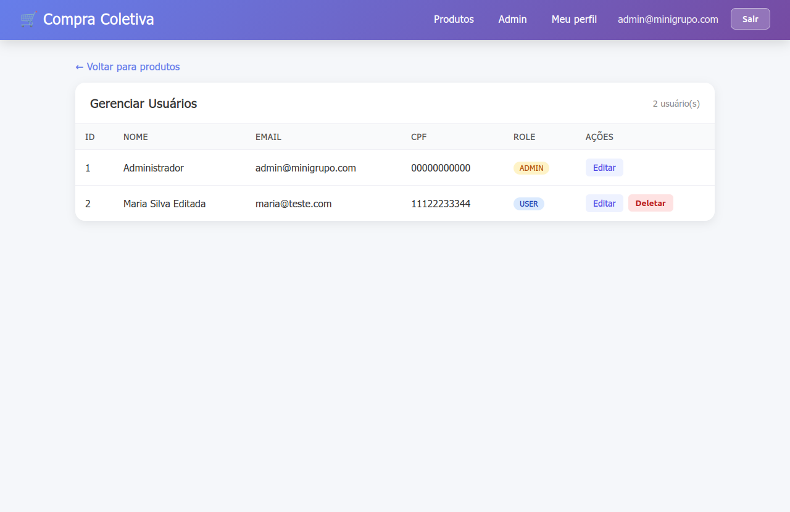
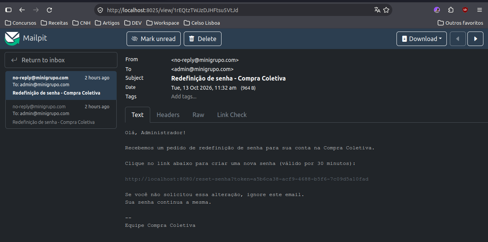

# 🛒 Compra Coletiva

Aplicação web de compras coletivas: usuários se cadastram, escolhem produtos
de informática e entram em grupos. Quando um grupo atinge a quantidade mínima
de participantes, o preço cai (15% de desconto). Grupos expiram
automaticamente após 7 dias.

> Projeto desenvolvido para estudo de Spring Boot com foco em boas práticas
> de arquitetura, segurança e testes automatizados.

---

## 📸 Screenshots

| Login | Produtos |
|---|---|
|  |  |

| Detalhes do grupo | Meu perfil |
|---|---|
|  |  |

| Admin — Usuários | Email de reset (Mailpit) |
|---|---|
|  |  |

> Crie a pasta `docs/` na raiz do projeto e coloque os prints lá com esses nomes.

---

## ✨ Funcionalidades

### 👤 Autenticação e conta
- Cadastro com validação (CPF, email único, senha criptografada com BCrypt)
- Login e logout com Spring Security (form login customizado + CSRF)
- Recuperação de senha via email com token de uso único (expira em 30 min)

### 🛍️ Compra coletiva
- Listagem de produtos com imagens
- Entrada em grupos de compra com um clique
- Página de detalhes do grupo com progresso, participantes e desconto aplicado
- Saída do grupo enquanto ele estiver aberto
- Scheduler que expira grupos vencidos automaticamente

### 🛡️ Autorização
- **Usuário comum:** visualiza produtos, entra em grupos, gerencia o próprio perfil
- **Admin:** gerencia todos os usuários (listar, editar, deletar)
- Regra de negócio: admin **não pode** deletar outro admin

---

## 🛠️ Stack

| Camada | Tecnologia |
|---|---|
| Linguagem | Java 21 |
| Framework | Spring Boot 4.1 |
| Persistência | Spring Data JPA + Hibernate + MySQL 8.4 |
| Segurança | Spring Security 6 (BCrypt, CSRF, form login, roles) |
| Template engine | Thymeleaf + Thymeleaf Extras Spring Security |
| Frontend | HTML + CSS puro |
| Email | Spring Mail + Mailpit (dev) |
| Mapeamento DTO | MapStruct |
| Boilerplate | Lombok |
| Testes | JUnit 5 + Mockito + AssertJ |
| Build | Maven (wrapper incluso) |
| Infra dev | Docker Compose (MySQL + Mailpit) |

---

## 🚀 Como rodar

### Pré-requisitos

- Java 21+
- Docker + Docker Compose

### Passos

```bash
# 1. Clone
git clone https://github.com/<seu-usuario>/compra-coletiva.git
cd compra-coletiva

# 2. Suba o banco de dados e o servidor de email de desenvolvimento
docker compose up -d

# 3. Rode a aplicação
./mvnw spring-boot:run
```

Acesse: [http://localhost:8080](http://localhost:8080)

### 👤 Usuário padrão (perfil `dev`)

| Campo | Valor |
|---|---|
| Email | `admin@minigrupo.com` |
| Senha | `123456` |
| Role | `ADMIN` |

> Criado automaticamente pelo `DataLoader` na primeira execução. Altere em
> produção.

### 🧪 Rodando os testes

```bash
./mvnw test
```

- **~30 testes de unidade** nos services (`UsuarioService`, `GrupoCompraService`, `PasswordResetService`)
- JUnit 5 + Mockito + AssertJ
- Cobrem caminho feliz, exceções de negócio e regras de segurança

---

## 📧 Testando "Esqueci minha senha"

Os emails **não saem para a internet**. Eles são capturados pelo **Mailpit**:

| Endereço | Para que serve |
|---|---|
| `localhost:1025` | SMTP — a aplicação envia aqui |
| [http://localhost:8025](http://localhost:8025) | Interface web — você lê os emails aqui |

O link de reset também aparece no console da aplicação (perfil `dev`), para
agilizar testes automatizados.

---

## 📂 Estrutura

```
src/main/java/com/guilherme/minigrupocompras/
├── config/         # DataLoader, SecurityConfig
├── controller/     # Controllers MVC (Login, Produto, Grupo, Perfil, Admin, PasswordReset)
├── dto/            # Form DTOs e Response DTOs (records)
├── entity/         # Entidades JPA (Usuario, Produto, GrupoCompra, Participacao, ...)
├── enums/          # Role, StatusGrupo, StatusPagamento
├── exceptions/     # Exceções customizadas + GlobalExceptionHandler
├── mapper/         # MapStruct mappers
├── repository/     # Spring Data JPA repositories
├── scheduler/      # Agendador de expiração de grupos
└── service/        # Regras de negócio

src/main/resources/
├── static/
│   ├── css/navbar.css
│   └── js/htmx.min.js
└── templates/
    ├── admin/
    ├── grupo/
    ├── perfil/
    ├── produto/
    ├── usuario/
    ├── login.html
    └── produtos.html
```

---

## 🔒 Decisões de segurança

- Senhas com **BCrypt** (`PasswordEncoder`)
- **CSRF** habilitado em todos os formulários POST
- **User enumeration evitado**: "esqueci a senha" sempre responde com sucesso,
  mesmo se o email não existir
- **Tokens de reset**: UUID aleatório, uso único, expiração de 30 minutos
- **Autorização por role** via Spring Security (`/admin/**` exige `ROLE_ADMIN`)
- **Defesa em profundidade**: tanto a UI quanto o backend validam as regras
  (ex.: admin não pode deletar outro admin)
- **Perfil do usuário**: `buscarPorEmailParaLogin(auth.getName())` — nunca
  confia em ID vindo da URL

---

## 🎯 Regras de negócio

### Grupo de compra
- Um grupo é criado automaticamente quando o primeiro usuário entra em um
  produto que não tem grupo aberto
- Meta de participantes = `produto.quantidadeMinima`
- Preço com desconto = 15% sobre o preço original
- Grupo expira 7 dias após ser criado
- Scheduler roda a cada 60 s e marca grupos vencidos como `EXPIRADO`
- Status possíveis: `ABERTO`, `SUCESSO`, `EXPIRADO`, `CANCELADO`

### Usuário
- Admin: lista, edita e deleta usuários (exceto outros admins)
- Usuário comum: edita e deleta a própria conta
- CPF e role **não** são editáveis

---

## 🗺️ Roadmap

- [x] Cadastro, login, logout
- [x] Recuperação de senha via email
- [x] Compra coletiva com grupos
- [x] Página de detalhes do grupo
- [x] CRUD de usuários (admin + perfil)
- [x] Testes de unidade nos services (JUnit + Mockito)
- [ ] Área administrativa para gerenciar produtos e cancelar grupos
- [ ] Notificação por email quando um grupo atinge a meta
- [ ] Fluxo de pagamento (entidade `Pedido` já existe)
- [ ] Paginação e busca na listagem de usuários (admin)
- [ ] Testes de integração (`@WebMvcTest`) para os controllers
- [ ] Deploy em produção

---

## 📄 Licença

Projeto de estudo — uso livre.